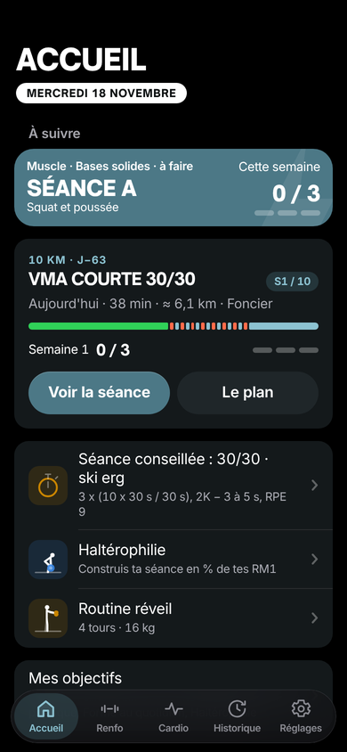
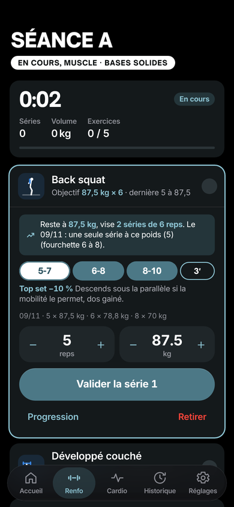
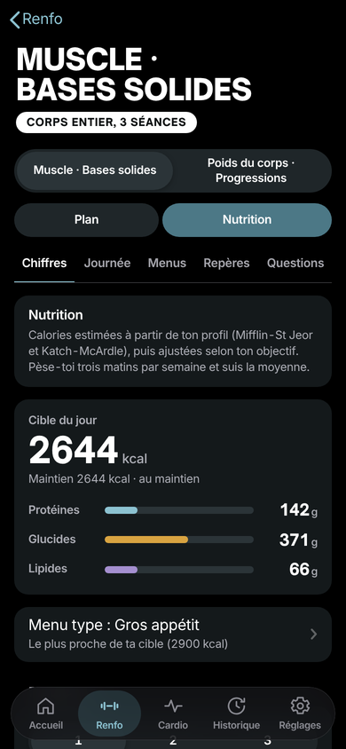
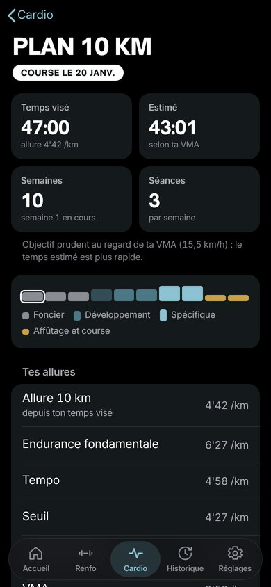
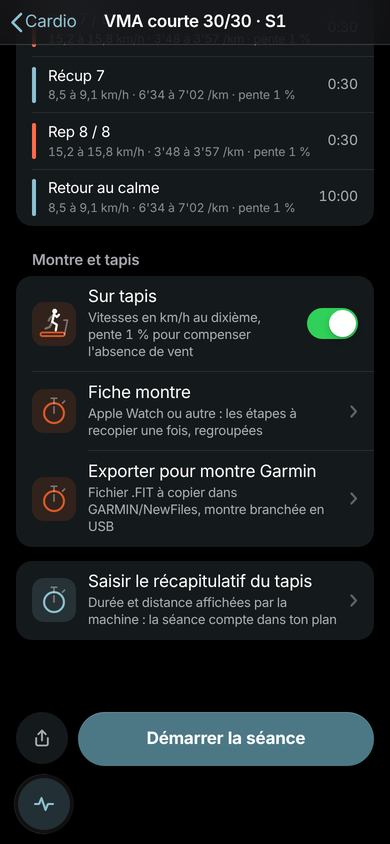
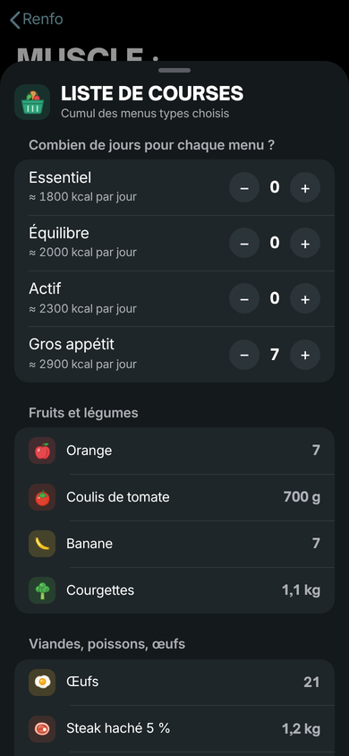

# Carnet

Carnet d'entraînement complet sur téléphone : musculation, poids du corps, course, cardio hybride, haltérophilie et nutrition. Application web installable (PWA), hors ligne, sans compte : les données restent sur le téléphone.

## Fonctions

**Accueil guidé par tes objectifs**
Tu choisis ce qui compte (muscle, poids du corps, course, condition physique, forme au quotidien, haltérophilie) et l'accueil affiche la prochaine séance de chaque objectif, la semaine en cours, la régularité et les records récents.

**Musculation**
- Programmes à suivre : séance du jour, progression d'une séance à l'autre, variantes 3 ou 4 jours.
- Séance guidée : charge conseillée selon la dernière séance, séries dégressives, chrono de repos, records personnels détectés.
- Modèles de séance, blocs de surcharge, séance libre, bibliothèque d'exercices avec pictogrammes animés.

**Poids du corps**
Progressions par niveaux pour chaque mouvement (tirage, poussée, dips, jambes, gainage), phases avec critères de passage, circuits lancés seuls avec chrono de maintien.

**Course et cardio**
- Plans de course 5 km, 10 km, semi et marathon : plan daté, allures calculées depuis la VMA ou le temps visé, semaines allégées, affûtage.
- Chrono guidé par étapes, catalogue de séances (VO2 max, seuil, ergomètres, workouts au chrono, routine réveil).
- Montre et tapis : export d'une séance en fichier .FIT pour montre Garmin, fiche d'étapes à recopier sur Apple Watch, mode tapis avec vitesses au dixième de km/h et pente conseillée.

**Haltérophilie**
RM1 par mouvement, séances par blocs en pourcentage, programmes intégrés, partage de séances du club par fichier ou lien.

**Nutrition**
- Cible calorique et macros calculées depuis le profil (Mifflin-St Jeor, Katch-McArdle) et l'objectif : maintien, perte de gras, prise de muscle.
- Journée type, assiette, menus types avec le plus proche de ta cible, repas à l'extérieur, repères et questions fréquentes.
- Liste de courses : nombre de jours par menu, quantités additionnées et rangées par rayon, partage ou copie.

**Historique**
Séances, volume, distance, tendances sur 12 semaines, régularité, records.

## Programmes

Deux programmes sont intégrés et écrits pour Carnet : **Muscle · Bases solides** (corps entier 3 séances ou haut et bas 4 séances, avec sa nutrition complète) et **Poids du corps · Progressions** (niveaux par mouvement, trois phases, circuits).

D'autres programmes, d'un coach, d'un auteur ou d'un club, s'importent en fichier JSON (`carnet-programme/1`). Ils restent sur le téléphone, ne sont jamais publiés avec l'application et s'ajoutent aux programmes existants sans les remplacer.

## Installer

Ouvre le site de l'application sur ton téléphone :
- **iPhone** : Safari, bouton Partager, « Sur l'écran d'accueil ».
- **Android** : Chrome, menu, « Installer l'application ».

L'application fonctionne ensuite hors ligne. Les notes de chaque version sont consultables dans Réglages > Notes de version.

## Données

Tout est stocké localement sur l'appareil (localStorage). Aucun compte, aucun serveur, aucun envoi de données. Exporte régulièrement une sauvegarde depuis Réglages : supprimer l'application efface ses données.

## Technique

- Application en un seul fichier `index.html` (HTML, CSS et JavaScript sans dépendance), service worker `sw.js` pour le hors ligne, `manifest.webmanifest`.
- Politique de sécurité du contenu (CSP) stricte : script autorisé par son empreinte, aucune ressource externe.
- Hébergement statique (GitHub Pages).

## Droits

Tous droits réservés. Le code est consultable mais aucune licence d'utilisation, de copie ou de redistribution n'est accordée.
